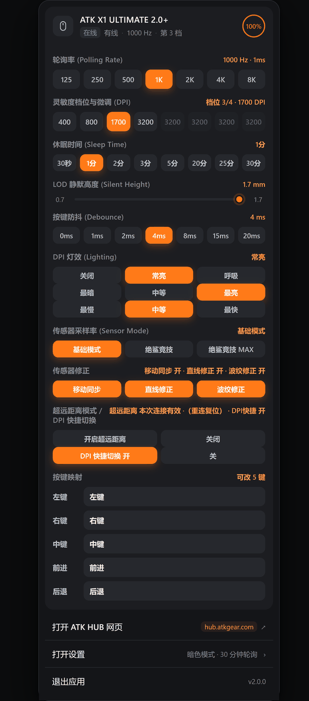
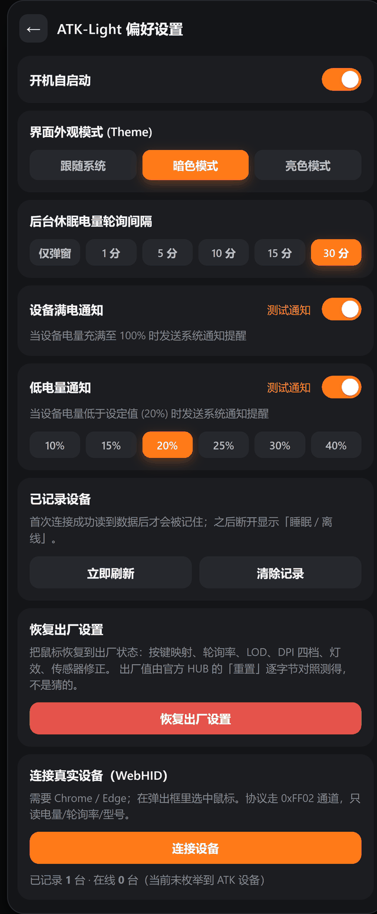

# ATK-Light

ATK 鼠标的轻量托盘面板（Windows），围绕设备自身的 USB HID 接口独立实现，纯前端单文件，离线可用。

> **适用范围：仅限 ATK 品牌产品，不适用于其他品牌。**
>
> 协议实现只针对 **ATK 设备**。罗技、雷蛇、达尔优、VXE 等其他品牌的命令表完全不同，
> 硬套本项目会读到错值，更糟的是写错位置可能把配置写坏。
>
> **ATK 品牌内部也要分产品线**：
>
> | 产品线 | 状态 |
> | --- | --- |
> | **鼠标** — ATK X1 ULTIMATE 2.0+（烈空 X1V2 大师+） | ✅ **已完整实测适配** |
> | 其他 ATK 鼠标型号 | ⚠️ 部分字段可能通用，但地址不保证一致 |
> | **ATK 键盘 / 耳机 / 手柄** | ❌ **未适配**——命令表不同，需单独实测 |
>
> 官方 ATK HUB 把鼠标、键盘、耳机放在同一个驱动里统一管理，但**每类设备的命令表是各自独立的**，
> 本项目只实现了鼠标这一套。要支持其他产品线，请用 `tools/usb-capture/` 自行抓包并修改代码；
> 本项目不提供移植支持，也不对其他设备上的使用后果负责。

## 找不到面板？

面板是**托盘应用**——它不占任务栏，默认躲在右下角托盘区。第一次用很容易以为"关了"。

| 情况 | 怎么办 |
| --- | --- |
| 想打开面板 | 单击右下角托盘区的 **ATK-Light 图标** |
| 图标被折叠进 `^` | 点任务栏那个 `^`，把图标拖到外面固定住 |
| 彻底找不到了 | 重新双击解压出来的 `ATK-Light-2.1.0.exe`（已启动会唤起、没启动会新开）<br>源码运行的话，双击 `ATK-Light-网页版/启动托盘版.bat` |
| 想彻底退出 | 面板底部「退出应用」，或托盘图标右键 → 退出 |
| 只是不想看它 | 点面板外面任意位置 —— **只是收起，程序还在托盘里** |

> **「点外面」和「退出应用」不是一回事**：前者收起面板、进程继续跑；后者才真正结束进程。
> 之前版本点「退出应用」其实没退出（只改了个文字），2.0.0 已修。

- **即时查看**：电量 / 连接方式 / 轮询率 / 当前 DPI 档位 / 休眠时间
- **直接调节**：轮询率、DPI 档位、LOD、按键防抖、DPI 灯效、休眠时间，点击立即写入设备
- **托盘常驻**：点右下角托盘图标，面板在图标正上方弹出，失焦自动收起
- **系统通知**：满电 / 低电量提醒
- **实时跟随**：面板可见时每 3 秒同步设备当前值，HUB 侧改动也能跟上

## 界面

### 主面板



### 偏好设置



## 功能特性

| 功能 | 说明 |
| --- | --- |
| 设备识别 | 通过 WebHID 直连 ATK 设备（`VID 0x373B`），自动枚举并记录 |
| 轮询率 | 125 / 250 / 500 / 1K / 2K / 4K / 8K 多档切换 |
| DPI 档位 | 最多 8 档独立数值，点档位切换当前档 |
| **按键映射** | **5 个可改键（左/右/中/前进/后退），7 项已确认动作** |
| LOD 静默高度 | 0.7 ~ 1.7 mm，步长 0.1 |
| 按键防抖 | 0 / 1 / 2 / 4 / 8 / 15 / 20 ms，低于 4ms 会警告 |
| DPI 灯效 | 模式（关闭 / 常亮 / 呼吸）+ 亮度三档 + 速度三档 |
| 传感器采样率 | 基础模式 / 绝鲨竞技 / 绝鲨竞技 MAX |
| 传感器修正 | 移动同步 / 直线修正 / 波纹修正 三个开关 |
| 超远距离模式 | 动作按钮（本次连接有效，重新连接会复位） |
| DPI 快捷切换 | 开关 |
| 休眠时间 | 30 秒 ~ 30 分多档 |
| **恢复出厂设置** | **一键复位按键、轮询率、LOD、DPI、灯效、传感器修正** |
| 电量监控 | 实时百分比，悬停显示 mV 与充电状态；满电 / 低电量**系统通知**（边沿触发，只在跨阈值时提醒一次） |
| **连接状态** | **三级捕捉**：L1 接收器断开（<1 秒）/ L2 鼠标睡眠（跟随设备休眠设置 +10 秒）/ L3 唤醒（3 秒内） |
| 状态联动 | 接收器断开时，同 VID 的鼠标记录一并标记；若有线仍在线则保留 |
| 档位变化提示 | 外部切档时 3 秒内弹提示，实时跟随设备当前值 |
| 主题 | 跟随系统 / 暗色 / 亮色三套配色 |
| **托盘显示电量** | 有设备在线时，托盘图标直接显示电量：**圆形电量环**（弧长随电量精确变化）/ **纯数字**（字号随位数自适应），可在设置页切换 |
| **深浅主题适配** | 托盘图标跟随系统主题：浅色任务栏用近黑、深色用近白 |
| **设备图标随状态变色** | 在线时卡片左侧的鼠标图标转 **ATK 橙**（`#ff7a18`），离线/睡眠时是浅灰，一眼能看出哪台活着 |
| 单实例 | 重复启动会提示已在运行，不会出现多个托盘图标 |

## 使用方式

| 方式 | 说明 |
| --- | --- |
| **下载 zip**（推荐） | 从 [Releases](https://github.com/yimeng007/atk-light/releases/latest) 下载 `ATK-Light-2.1.0.zip`，解压后双击里面的 exe |
| **纯网页** | 直接打开 `ATK-Light-网页版/index.html`（Chrome / Edge 支持 WebHID 读真实设备） |
| **托盘版（开发）** | `ATK-Light-网页版/启动托盘版.bat` |

> **自 2.0.0 起不再单独提供 exe**，改为 zip 打包（内含 `免责声明.txt` / `LICENSE` / `使用说明.txt`）。
> 原因是单文件 exe 是自解压包，用户看不到内部文件，而 MIT 要求许可声明须随副本分发。
> 1.1.5 及更早版本仍是单 exe，保持原样。

## 技术架构

- **运行形态**：单页应用（SPA）+ Electron 托盘壳，两种运行方式共用同一份前端
  - 纯网页版：直接用浏览器打开 `index.html`，走浏览器原生 **WebHID API** 直连设备
  - 托盘版 / 独立 exe：Electron 负责托盘图标 + 失焦收起，`preload.js` 用 `contextBridge` 暴露 `shell.openExternal` 与面板收起 IPC，页面本身仍走 WebHID
- **设备通信**：USB HID 的厂商自定义通道（`VID 0x373B`），16 字节命令帧 + 校验和；协议方法见下方「技术要点」与 `tools/usb-capture/README.md`
- **技术栈**：原生 HTML / CSS / JavaScript（无框架、无构建步骤），Electron 28 + electron-builder 打包
- **状态持久化**：设备记录与偏好存 `localStorage`，离线可用
- **写入策略**：所有设备写入都是「读整块 → 改目标字节 → 写回 → 立即回读校验」，
  校验不符会提示，不做乐观更新
- **危险操作防护**：改左键、防抖低于 4ms、恢复出厂设置都会先弹面板内确认层（非系统弹窗，不抢焦点）
- **关键细节**：当前档位字段为 **0 基编号**（设备 `0` = 第一档），「改数值」与「切档」是两个独立写入动作
- **窗口显隐**：不用 `hide()/show()`，改用 `setOpacity(0/1)`。`hide()` 会让 Chromium 释放合成层
  的 GPU 纹理，再 `show()` 时要逐帧重建（约 125ms，120fps 录屏能逐帧看到）。
  常驻透明窗口多占 30-50MB，但弹出是一帧到位
- **渲染进程权限**：preload 跑在 **sandbox** 里，只能拿到 `contextBridge` / `ipcRenderer`。
  `shell`、`app` 这类必须在主进程用、通过 IPC 暴露——早期直接在 preload 调 `shell.openExternal`
  一直是静默失败（`shell` 是 undefined），只是没人点那个按钮所以没暴露
- **状态检测**：三级——L1 枚举消失（插拔事件，<1 秒）/ L2 连续读不到超时 / L3 恢复读取。
  超时阈值跟随设备自身休眠设置（`sleepUnits × 10 + 10` 秒），插拔走 `navigator.hid` 的
  `connect` / `disconnect` 事件

## 相关链接

- 官方 HUB 网页版：<https://hub.atk.pro/>
- 官方 HUB 网页版（备用入口）：<https://v3-hub.atkgear.com/>
- 官方商城 / HUB 桌面版下载：<https://www.atkgear.com/>（本项目为独立实现，不依赖官方 HUB）

## 目录结构

```
ATK-Light/
├── ATK-Light-网页版/              # 面板源码
│   ├── index.html                 # 主界面 + 全部逻辑（单文件，无构建步骤）
│   ├── tray-main.js               # 托盘宿主：窗口显隐 / 自启动 / 退出 / 单实例
│   ├── preload.js                 # contextBridge：渲染层能调哪些主进程能力
│   ├── package.json               # Electron 壳配置
│   ├── assets/                    # 应用图标 / 托盘图标
│   ├── 启动托盘版.bat              # 源码运行入口（需本机有 electron）
│   └── 说明.md                     # 面板各项设置的逐条说明
├── tools/usb-capture/             # USB 协议观察与适配
│   ├── USBPcapSetup-1.5.4.0.exe   # 抓包驱动安装包（GPLv2 / BSD）
│   ├── capture.js                 # 录包脚本
│   ├── parse.js                   # 解析脚本：--fields 聚合 / --diff 对比
│   ├── adapter-guide.md           # 适配新设备的 8 步指南（含 AI 话术）
│   └── README.md                  # 用法 + 分析方法 + 蓝牙说明
├── docs/images/                   # 界面截图（主面板 / 偏好设置）
├── ATK中心.url                     # 官方 HUB 快捷方式
├── CHANGELOG.md                   # 逐版本变更记录
├── LICENSE                        # MIT（英文原文 + 中文说明）
├── 免责声明.txt                    # 独立免责声明（七章，随 zip 分发）
├── 使用说明.txt                    # 五步上手（随 zip 分发）
└── README.md
```

<a id="tech"></a>
## 技术要点

> 这里只写**方法**，不列具体地址和编码。原因见本节最后一段。

### 协议结构（可以照着做的部分）

- 走 USB HID 的自定义通道，命令帧**定长 16 字节**，末字节是校验和
- **单次读取上限 10 字节**：请求长度 ≥ 12 时设备直接返回 `status=1`，
  看起来像"地址不存在"，其实是**长度超限**。
  判断法：同一地址用 10 读得到、用 12 读不到，就是长度问题
- 参数区普遍是「**值 + 补码**」成对出现（相邻两字节之和为常数），
  据此可以切分字段边界，比盲扫快得多
- 索引类字段常带**自己的 CRC**，相邻字节能互相验证
- 当前档位是 **0 基编号**（设备 `0` = 第一档），显示时 +1
- 「改数值」与「切到该档」是**两个独立写入动作**，不能合并成一次

### 行为特征（与具体地址无关）

- 有些设置是**运行时命令、不写 EEPROM**：改动后断电重连会复位，也没有查询命令
  （发出去就是改状态）。判断法：改完**断电重连再读**，回默认的就不是持久设置
- **按键表**是固定长度的记录数组，每条 4 字节。官方 HUB 只开放其中前几条，
  其余是设备内部固定功能，改了也不会生效
- 按键编码分两类：**鼠标按键**（用位掩码，左/右/中/侧键各占一位）和**其他功能**
- **索引顺序不等于物理位置**：实测侧键的两个索引与 HUB 界面上的上下顺序相反。
  以 HID 标准的按钮位为准，别按界面的直观顺序猜

### 状态检测

- 三级：L1 枚举消失（`navigator.hid` 插拔事件，<1 秒）/ L2 连续读不到超过
  「设备自身休眠设置 + 10 秒」/ L3 重新读到（3 秒内）
- 面板每 3 秒读一次头部队列与当前 DPI 槽位，用于跟上 HUB 侧的改动
- 同一型号在无线接收器与有线下的 **PID 不同**，句柄匹配要按 `VID + 产品名` 兜底

### 为什么这里不给地址表

这份表是在**一台设备上逐字节试出来的**，换型号就不成立——照抄只会读到错值，
更糟的是写错位置可能把配置写坏。

**真正可复用的是方法，不是答案**：

1. 用 `tools/usb-capture/` 记录一次「改设置」前后的完整通信
2. 按「改一处、看哪里变」定位字段（比盲扫可靠得多）
3. 对照 `ATK-Light-网页版/index.html` 里的读写函数改写

**出厂值**同理——是在官方 HUB 里点一次「重置」、对比前后 320 字节 EEPROM 得出的，
不同型号默认值不一样，必须用同样方法自己测。

<a id="adapt"></a>
## 适配新设备（AI 协作流程）

> 这一节写给想把这套东西扩展到**别的型号**的人——包括 ATK 的键盘、耳机，
> 也包括完全不同的品牌（那种情况下几乎要重写）。
>
> 核心思路：**AI 负责「看得见的活」，人负责「判断和取舍」**。

### 三步快路径

```bash
# 1. 抓包：记录「改设置前 / 后」两次通信
node tools/usb-capture/capture.js "\.\USBPcap1" before.pcap 30   # 改之前
node tools/usb-capture/capture.js "\.\USBPcap1" after.pcap 30    # 改完一项再抓

# 2. 对比：脚本告诉你哪些地址变了
node tools/usb-capture/parse.js --diff before.pcap after.pcap

# 3. 改代码：把地址写进 index.html 的读写函数
```

📖 **详细分步指南**（含每步该问 AI 什么、常见失败模式）：
[`tools/usb-capture/adapter-guide.md`](tools/usb-capture/adapter-guide.md)

### 仓库树 · AI 在每处能帮什么

```
ATK-Light/
├── ATK-Light-网页版/
│   ├── index.html                ← 主战场，改设备基本只动这里
│   │   ├── ATK.ask / readBytes       「改成分批读，每次最多 10 字节」
│   │   ├── readDevice()              「读不到数据，加日志看哪一步失败」
│   │   ├── writeLod / writeDebounce  「照这个模式再加一个写 X 的函数」
│   │   └── renderDevices()           「加一行显示新字段」
│   ├── tray-main.js              ← 窗口/托盘层，改设备时一般不碰
│   ├── preload.js                ← IPC 白名单，新增主进程能力时同步改
│   └── 说明.md                    ← 用户手册，加新功能时更新
├── tools/usb-capture/
│   ├── capture.js                ← 抓包，一般不用改
│   ├── parse.js                  ← 「解释这段 --diff 输出，哪个地址最像目标字段」
│   └── README.md                 ← 「我的设备没有读配置帧，怎么办」
└── README.md                     ← 你正在看的这份
```

**用法举例**（把整段丢给 AI 即可）：

> 我用 `parse.js --diff` 对比了改 LOD 前后的两个 pcap，输出的变化地址是
> `0x0012`（1 处）、`0x0034`（2 处）、`0x0056`（1 处）。我改的是 LOD 从 1.1 到 1.3。
> 哪个最可能是 LOD？怎么验证？

AI 会帮你列候选、给排除思路（比如"再改一项、再抓、看哪个地址变了两次"），
**但最终要靠你自己改一项、再抓一次来验证**。

### 人机分工（重要）

| 环节 | 谁做 | 为什么 |
| --- | --- | --- |
| 抓包、改设置、观察现象 | **人** | AI 碰不到你的设备 |
| 解析 pcap、比对差异、整理候选 | **AI** | 机器不会看漏，几百个字节都能对齐 |
| 判断「哪个地址是目标字段」 | **人 + AI 交叉** | AI 给候选，人改一项验证 |
| 写代码、改函数 | **AI** | 有完整上下文，能照现有模式写 |
| **决定「能不能写」** | **人** | 写错可能写坏设备，责任在人 |
| 测试手感、反馈现象 | **人** | 只有你知道用起来对不对 |

> ⚠ **写之前一定先读原值备份**。不同型号的出厂值不一样，"恢复出厂"未必救得回来。

### 想 fork 一个自己的版本？

可以，这正是开源的做法：

1. Fork 本仓库
2. 按上面的流程适配你的设备
3. 改 `package.json` 的名字和版本，发自己的 Release
4. **不需要**征求同意（MIT 许可允许），但请保留 LICENSE 和原作者署名

如果适配的是 ATK 的其他产品线（键盘 / 耳机），欢迎回来提 PR——
但请附上你自己的实测数据，**没实测过的代码不会合并**。

<a id="scope"></a>
## 适用范围

本项目只对**手头这一只鼠标**做过适配：

| 项 | 值 |
| --- | --- |
| 型号 | **ATK X1 ULTIMATE 2.0+**<br>中文名 **烈空 X1V2 大师+**（Blazing Sky X1 V2 Ultimate 2.0） |
| VID | `0x373B` |
| PID | 有线 `0x1286` / 2.4G 接收器 `0x4728` |
| 硬件 | PAW3950 Ultra 传感器 · Nordic 54L15 · 光学微动 · 有线 + 2.4G 双模 |

要支持别的型号，可行路径是：用 `tools/usb-capture/` 里的工具记录一次「改设置」的流量，
按「改一处再看哪里变」定位字段，再对照 `ATK-Light-网页版/index.html` 里的读写函数改写。
本项目**不提供**其他设备的现成字段表。

## 已知限制

**状态与显示**

- **无线模式下判不出「睡眠」**：接收器会代理响应，鼠标睡了接口仍返回数据。
  「能读到」和「设备醒着」在这个协议下无法区分。有线模式则根本不进入睡眠。
- **同一只鼠标会显示两条记录**（无线接收器 + 有线本体），因为它们是两个不同的 HID 端点。
- **休眠设得长时，异常发现也慢**：面板的检测周期跟随你设置的休眠值，
  设 30 分钟就要等 30 分钟才判定离线。这是设计取舍（避免频繁唤醒设备），不是卡死。
- **窗口常驻内存约 30-50MB**：为实现零闪烁，面板窗口不真正销毁，只是移出屏幕。
  不占任务栏、不挡鼠标。

**功能覆盖**

- **改键只开放 5 个键**：其余 11 条 EEPROM 记录是设备内部固定功能（如板载切换），暂不暴露。
- **动作编码只收录 7 项**：板载配置切换、DPI±、键盘按键、快捷指令尚未对照验证。
- **板载配置档 / 宏：暂无界面**：协议帧已知，但含义未完全逆清，不冒险写入。
- **无蓝牙**：本型号本身只有「有线 / 2.4G」两种连接，没有蓝牙硬件。

## 关于蓝牙

本项目不涉及蓝牙：**这一型号本身只有有线与 2.4G 两种连接方式，没有蓝牙功能**
（官方参数写法是 `Connectivity: Wired / 2.4GHz`），所以不是"没做"，是这只鼠标确实没有这条通道。

另外，观察工具 USBPcap 是 **USB 总线**嗅探器，蓝牙走的是 HCI 协议栈、不在这条总线上，
即使将来换了带蓝牙的设备也用不上这套工具。

需要研究蓝牙的话，可以走 Windows 的 **ETW / HCI 日志**（`bthhfenum` 相关事件），
或按 Wireshark 的蓝牙抓包指引操作。这部分本项目没有实践，留给有兴趣的人自行探索。

## 许可

本项目以 [MIT License](LICENSE) 发布（英文原文 + 中文说明）。可自由用于个人与商业场景，
保留版权与许可声明即可。

> **关于商业使用的边界**
>
> 本项目**未获 ATK（及其母公司、关联方）授权**，与其无任何隶属或合作关系。
>
> MIT 许可只约束**代码本身的使用**。任何基于本项目的**销售、代运营、捆绑分发、
> 付费支持**等商业行为，均**与本项目作者无关**：作者不参与、不分成、不背书，
> 也不承担由此产生的任何连带责任。
>
> 如果你的商业场景涉及「ATK」等商标的使用，请自行取得商标权利人的许可。

## 随包文本

Release 除了 exe，还提供一个 zip，内含三份文本（UTF-8 with BOM，Windows 记事本可直接打开）：

| 文件 | 内容 |
| --- | --- |
| [`免责声明.txt`](免责声明.txt) | 项目性质 / 适用范围 / 风险提示 / 无担保 / 责任限制 / 知识产权 / 使用即同意 |
| [`LICENSE`](LICENSE) | MIT 英文原文 + 中文说明 |
| [`使用说明.txt`](使用说明.txt) | 启动 / 找不到面板 / 首次连接 / 功能一览 / 安全提示 |

> **exe 是自解压包，用户看不到内部文件**，所以许可与免责文本必须单独放出来。
> 只下载单 exe 也能运行，但条款同样适用。

## 免责声明

本项目是**独立的第三方个人项目**，与 ATK（及其母公司、关联方）**无任何关系**，
未获得其授权、赞助或背书。

- 项目中的「ATK」「ATK HUB」等名称仅用于说明本工具所针对的设备型号，属合理指称；
  相关商标、标识归其各自权利人所有。
- 本项目通过公开的 USB HID 接口与设备通信，仅用于**个人学习、研究与设备自用**，
  不包含、不复制、不分发任何 ATK 官方软件或受版权保护的代码。
- 使用本项目可能使设备保修失效、或与官方软件的配置产生冲突，请自行评估风险；
  因使用本项目造成的任何设备损坏或数据损失，作者不承担责任。

## 更新日志

见 [CHANGELOG.md](CHANGELOG.md)。

---

**下载或使用本项目，即表示你已阅读并同意上述免责声明与许可条款。**
